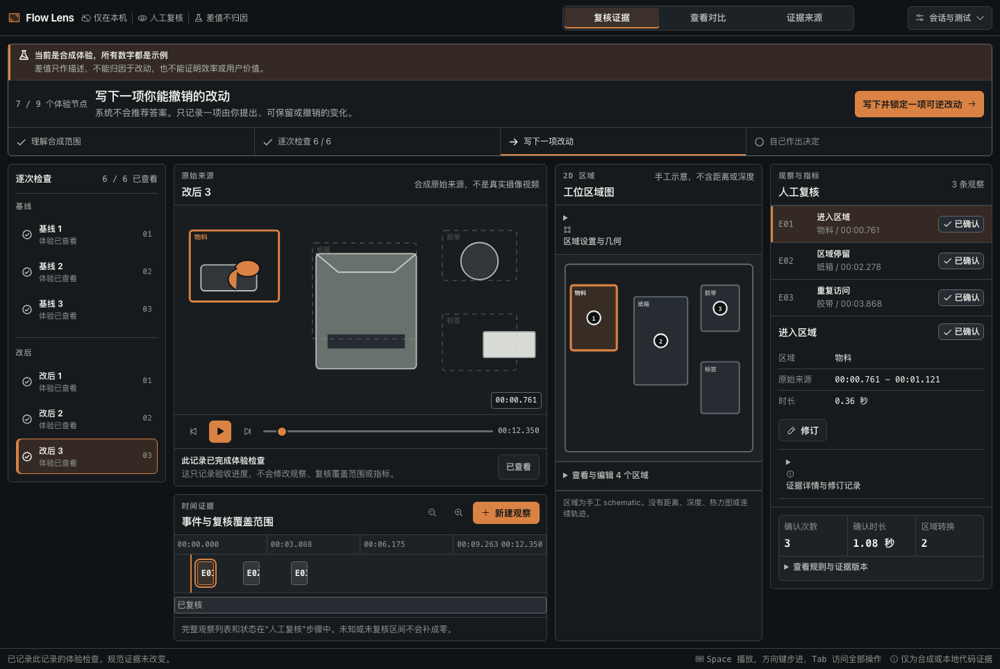
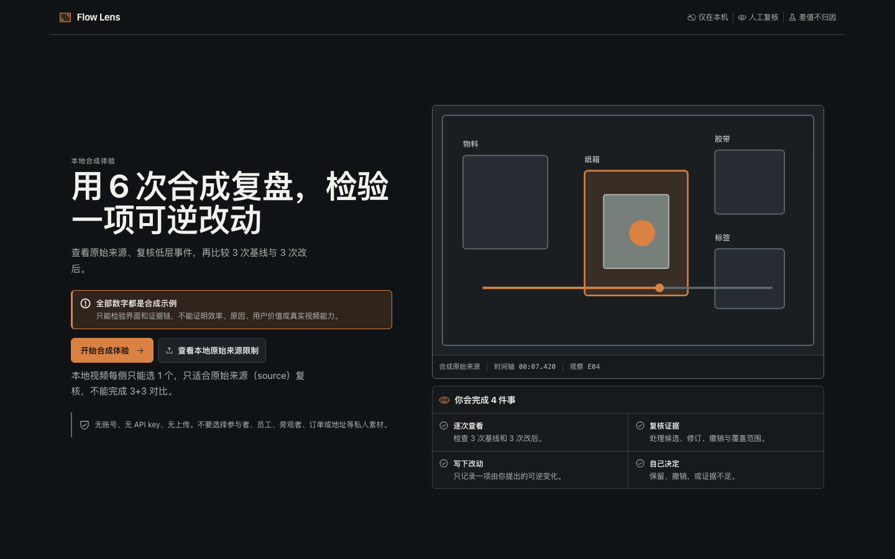
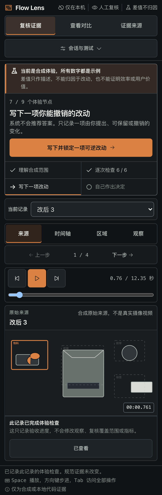

# Flow Lens

[](https://github.com/Jeffreyliu0131/flow-lens/actions/workflows/ci.yml)

Flow Lens is an **experimental local portfolio preview** for manually reviewing repeated-work evidence. The current demo uses a deterministic synthetic fixed-workstation packing fixture, immutable corrections, coverage-gated metrics, and a descriptive 3 Before + 3 After comparison.

**Evidence verdict: Validate first.** The need, target user, real-video reliability, correction burden, and workflow value are not validated. No independent user acceptance has been recorded.

Flow Lens is not a production tool and does not implement computer vision, AI analysis, automatic tracking, recommendations, 2.5D, or 3D.



## What this repository demonstrates

- a local-only, no-account static React application;
- a deterministic programmatic source instead of private workflow footage;
- manual region and low-level event review;
- proposed, confirmed, edited-final, rejected, and uncertain evidence states;
- immutable revision history and restore-as-new-revision;
- full-coverage and zone-fingerprint gates before metrics;
- exact 3+3 guided synthetic review;
- non-compensatory comparability, observability, guardrail, and source checks;
- a descriptive difference with attribution explicitly not established;
- one user-authored reversible change and keep/revert/uncertain decision;
- desktop, 390 px, 320 px, keyboard, reduced-motion, and forced-colors paths;
- production `connect-src 'none'` and a no-egress test harness.

It does **not** demonstrate real-camera accuracy, annotation correctness, causal improvement, privacy compliance, secure deletion, employee monitoring, or production readiness.

## Run locally

Requirements:

- Node.js 22.12 or newer
- npm
- no API key

```bash
npm ci
npm run dev
```

Open [http://127.0.0.1:4175](http://127.0.0.1:4175).

The default path is fully synthetic and model-free.

## Guided experience

1. Confirm the synthetic-data and claim boundary.
2. Inspect exactly 3 Before and 3 After records.
3. Resolve any proposed evidence and coverage blocker.
4. Check six non-compensatory comparison conditions.
5. Write one reversible change yourself.
6. Read the descriptive difference and alternative explanations.
7. Choose keep, revert, or uncertain. The system does not recommend an answer.

On mobile, review is a four-step source → timeline → region → observation flow.

For a structured walkthrough, use [EXPERIENCE_ACCEPTANCE.md](EXPERIENCE_ACCEPTANCE.md). Passing that walkthrough would describe this local preview only; it would not validate the product hypothesis.

## Local media warning

The optional local path accepts one Before and one After `video/*` file as session-only browser object URLs. It does not upload or persist media, but it is not a secure/private-data workflow and cannot complete the guided 3+3 comparison.

**Do not use participant, employee, customer, bystander, order, address, voice, or other private media.** Use the programmatic fixture or the committed generated WebM lifecycle fixture for bug reports.

See [Privacy and data boundary](docs/PRIVACY.md).

## Verify

```bash
npx playwright install chromium
npm run lint
npm run typecheck
npm test
npm run build
npm run check:no-egress
npm run e2e
npm run e2e:production
npm run check:public
```

See [Testing](docs/TESTING.md) for coverage and evidence limits.

## Screenshots

### First run



### Mobile review



All screenshots show only the project-authored synthetic interface.

## Documentation

- [Architecture](docs/ARCHITECTURE.md)
- [Privacy](docs/PRIVACY.md)
- [Fixtures and asset provenance](docs/FIXTURES.md)
- [Known limitations](docs/KNOWN_LIMITATIONS.md)
- [Testing](docs/TESTING.md)
- [Decision record](docs/DECISION_RECORD.md)
- [Product concept brief](PRODUCT_BRIEF.md)

## Contributing and security

Read [CONTRIBUTING.md](CONTRIBUTING.md) before opening a pull request. Use synthetic reproductions only.

For security issues, follow [SECURITY.md](SECURITY.md) and use GitHub's private security advisory flow. Do not post secrets or private media in a public issue.

## License

Code and project-authored committed assets are available under the [MIT License](LICENSE). See [ASSET_LICENSE.md](ASSET_LICENSE.md) for fixture and screenshot details. Third-party dependencies retain their own licenses.
